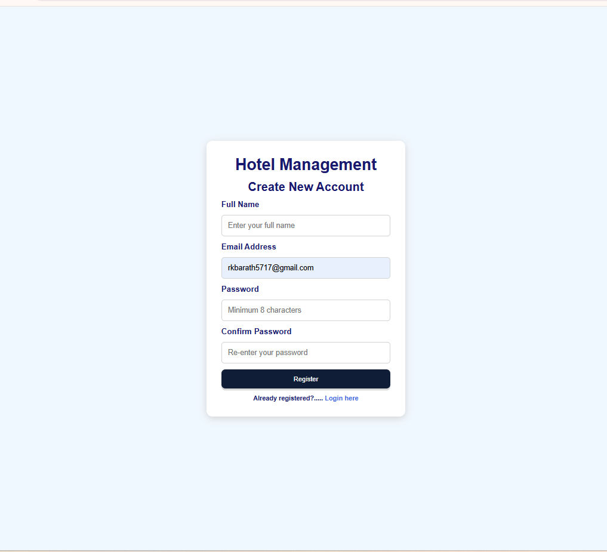
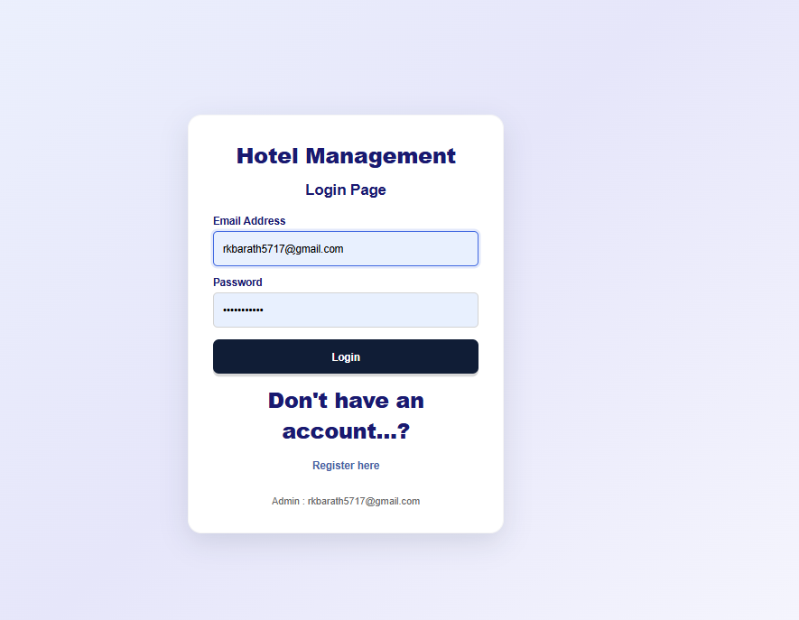
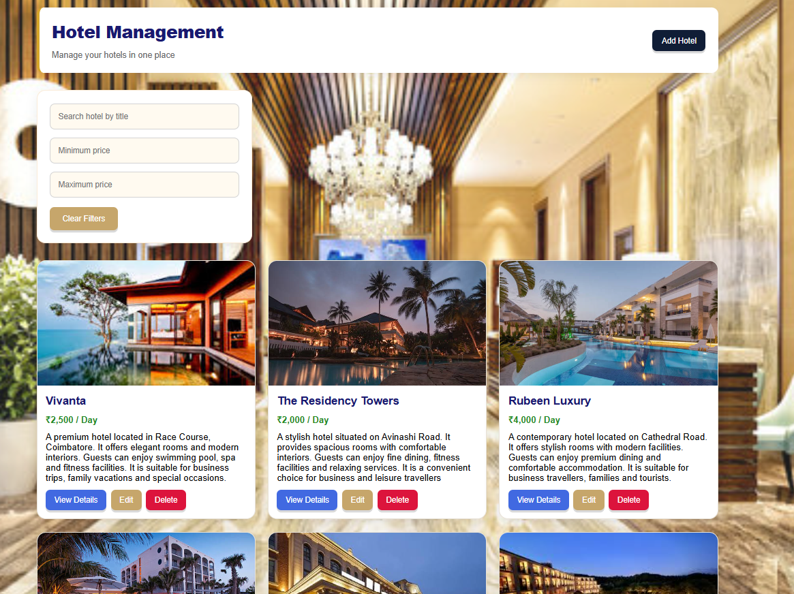

# Hotel Management System
## 1. Project Overview

The Hotel Management System is a web-based application developed using React.js for the frontend and Node.js with Express.js for the backend.

The main objective of this project is to simplify hotel information management through a user-friendly interface. It allows administrators to manage hotel details and users to view available hotels, search for hotels and explore their locations.

## 2. Project Objectives

- Develop a responsive and user-friendly hotel management application.
- Implement user registration and login authentication.
- Provide role-based access for Admin and User.
- Perform hotel CRUD operations.
- Implement hotel search, price filtering and pagination.
- Upload and display hotel images.
- Display hotel locations using latitude and longitude.

## 3. Technologies Used

### Frontend
- React.js
- Vite
- JavaScript
- HTML5
- CSS3
- React Router DOM

### Backend(dummy backend)
- Node.js
- Express.js
- REST API

### Authentication and Security
- JSON Web Token (JWT)
- bcryptjs
- Role-based authorization

### Data Storage
- JSON files for hotel and user information

### Other Tools and Libraries
- Multer – Image uploading
- CORS – Frontend and backend communication
- OpenStreetMap – Hotel location display
- VS Code – Development environment
- npm – Package management

## 4. Main Features

### User Registration
- Full name, email and password fields.
- Email format validation.
- Password and confirm password validation.
- Duplicate email checking.
- Password hashing before storage.

### Login and Authentication
- User and Admin login.
- JWT-based authentication.
- Protected API routes.
- Role-based access control.

### Admin Features
- Add new hotel details.
- View hotel information.
- Edit existing hotel details.
- Delete hotel records.
- Upload hotel images.

### User Features
- View available hotels.
- Search hotels by name.
- Filter hotels based on price.
- Navigate hotel listings using pagination.
- View complete hotel details.
- Explore hotel locations on a map.


## 5. Project Folder Structure

    Hotel-Management/
    |
    |-- backend/
    |   |-- data/
    |   |   |-- hotels.json
    |   |   |-- users.json
    |   |   |-- admins.json
    |   |
    |   |-- middleware/
    |   |   |-- authentication.js
    |   |
    |   |-- uploads/
    |   |-- server.js
    |   |-- package.json
    |   |-- package-lock.json
    |
    |-- src/
    |   |-- assets/
    |   |-- Components/
    |   |   |-- HotelCard.jsx
    |   |   |-- HotelForm.jsx
    |   |   |-- Navbar.jsx
    |   |
    |   |-- Pages/
    |   |   |-- HotelDetailPage.jsx
    |   |   |-- HotelListPage.jsx
    |   |   |-- LoginPage.jsx
    |   |   |-- RegisterPage.jsx
    |   |
    |   |-- Store/
    |   |-- App.jsx
    |   |-- App.css
    |   |-- index.css
    |   |-- Login.jsx
    |   |-- main.jsx
    |
    |-- public/
    |   |-- hotel-logo.png
    |   |-- icons.svg
    |
    |-- index.html
    |-- package.json
    |-- package-lock.json
    |-- README.md
    |-- .gitignore
    |-- vite.config.js


## 6. Component Description

| Component | Responsibility |
|---|---|
| App.jsx               | Main application component and navigation 
| Navbar.jsx            | Application navigation bar 
| HotelCard.jsx         | Displays individual hotel information 
| HotelForm.jsx         | Add and edit hotel details 
| HotelListPage.jsx     | Displays hotel listings, search, filters and
pagination 
| HotelDetailPage.jsx   | Displays complete hotel information and map 
| Login.jsx             | Handles user/Admin login 
| LoginPage.jsx         | Login page component, if used in the final implementation          
| RegisterPage.jsx      | Handles new user registration 

## 7. Backend API Endpoints
------------------------------------------------------------------
| HTTP Method | Endpoint | Purpose |
|---|---|---|
| POST | `/api/auth/register` | Register a new user |
| POST | `/api/auth/login` | Authenticate a user |
| GET | `/api/hotels` | Retrieve hotel listings |
| GET | `/api/hotels/:id` | Retrieve a hotel by ID |
| POST | `/api/hotels` | Add a hotel |
| PUT | `/api/hotels/:id` | Update hotel details |
| DELETE | `/api/hotels/:id` | Delete a hotel |

**Note:** Admin-only operations must be protected by authentication and authorization middleware.


## 8. Test Cases

| Test ID | Test Scenario | Expected Result |
|---------|---------------|-----------------|
| TC01 | Valid user registration | Account created |
| TC02 | Invalid email registration | Validation error |
| TC03 | Password mismatch | Error message displayed |
| TC04 | Duplicate email registration | Registration rejected |
| TC05 | Valid user login | User logged in |
| TC06 | Invalid login credentials | Login rejected |
| TC07 | Admin login | Admin access granted |
| TC08 | Add hotel | Hotel added successfully |
| TC09 | View hotels | Hotel list displayed |
| TC10 | Edit hotel | Hotel updated successfully |
| TC11 | Delete hotel | Hotel deleted successfully |
| TC12 | Search hotel | Matching hotels displayed |
| TC13 | Price filtering | Matching price results displayed |
| TC14 | Pagination | Correct page displayed |
| TC15 | View hotel details | Hotel details displayed |
| TC16 | Map location | Hotel location displayed |
| TC17 | User attempts Admin action | Access denied |
| TC18 | Logout | User session cleared |

## 9. Installation and Execution

### Step 1: Clone or download the project

Open the project folder in VS Code.

### Step 2: Install frontend dependencies

```bash
npm install
```

### Step 3: Install backend dependencies

```bash
cd backend
npm install
```

### Step 4: Backend url & Frontend url

node server.js

Backend  URL: http://localhost:5000
Frontend URL: http://localhost:5173

### Step 5: Start the Frontend and Backend at the same time

important comment:-
        npm run start:all

                -> This is used to run both the frontend and backend at the same    time

## 10. Future Enhancements

- Integrate MySQL or MongoDB for persistent database management.
- Implement a dedicated Admin Management module.
- Add hotel booking and reservation functionality.
- Add payment gateway integration.
- Add email verification and password reset.
- Deploy the application to a cloud platform.


## 11. System Architecture

The application follows a client-server architecture.

- Frontend: React.js with Vite.
- Backend: Node.js and Express.js.
- Communication: REST API using HTTP requests.
- Authentication: JWT-based authentication.
- Storage: JSON files for demo data.
- Image Management: Multer for image uploads.

The frontend communicates with the backend through REST API endpoints to perform hotel management operations.


## 9. Project Screenshots

### 1. Registration Page


### 2. Login Page


### 3. Hotel Listing Page


### 5. Hotel Details and Location Map


## 10. Project Demo Video

Watch the complete demonstration of the Hotel Management System:

[Watch Project Demo]()


## 12. Conclusion

The Hotel Management System demonstrates the implementation of a full-stack web application using React.js, Node.js and Express.js. It combines frontend development, REST API integration, authentication, authorization, file uploads and hotel information management in a single application.

The project provides practical experience in full-stack development and can be extended with database integration, booking management and additional hotel services.


In this project i try to impelement by all the innovative ideas and basic requirements from the task in future maybe i will add the backed using Node.js or SpringBoot and as well as i try to integrated my database using mySQL or POSTERSQL


------------------------THANK YOU !------------------------------------------------